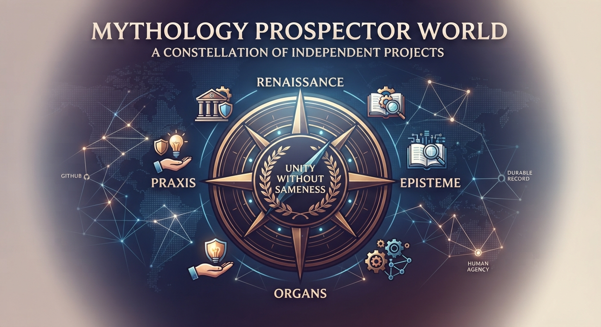

# Mythology Prospector World

> The durable landing point for the mythologyprospector-hub project world.

This repository is the **world-level orientation layer**.

It does not own the internal architecture of the projects it maps. Each project remains sovereign and keeps its own canon, architecture, tests, and decisions.

## Start here

For a fresh session, point the assistant at this repository and begin with [HANDOFF.md](HANDOFF.md). It defines how to re-ground in World, survey the factory, choose the next justified direction, and leave durable continuity without depending on yesterday's conversation.

The governing references are:

1. [GENIE_PROTOCOL.md](GENIE_PROTOCOL.md) — learn how to ask, give the wish a durable home, then drive the work.
2. [AGENT.md](AGENT.md) — world-level agent boundaries.
3. [WORLD.md](WORLD.md) — mission and project sovereignty.
4. [WORKFLOW.md](WORKFLOW.md) — working method, Miracle Tokens, and long-running work.
5. [REPOSITORIES.md](REPOSITORIES.md) — public project map.
6. [MACHINE.md](MACHINE.md) — local development layout.
7. [JIMMYDEV.md](JIMMYDEV.md) — the human purpose and standards behind the work.

Then enter the relevant project's own repository and read its canonical documents before changing anything.

## Governing idea

**The whole GitHub world is the unit of orientation. Individual repositories are the units of ownership and implementation.**

The world map tells an agent where to look. Project canon tells it what is true inside that project.

## Authority

This repository is authoritative for **world-level orientation and workflow only**.

It must never silently override a project's own canon.
